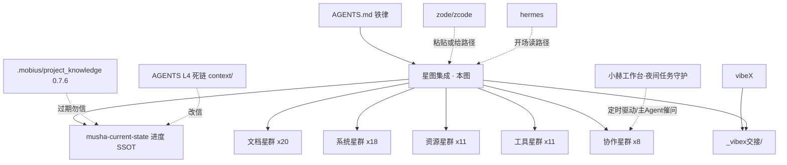

# 星图集成 — Musha 项目星图（人 / LLM / 软件三读）

> **新 AI 接手读序（就这 4 步）：**
> ① `AGENTS.md`（铁律）→ ② 本图（导航 + 谁是权威 + 谁已过期）→ ③ `musha-current-state.md`（进度 SSOT）→ ④ 按星表 `path` 下钻。
> **机器读法**：只读下方 ` ```json ` 星表，Python `json.loads` 零依赖；`path` 全是本机绝对路径（正斜杠）。
> **人 / LLM 读法**：读正文即可，细节在各星 `path` —— 本图**只做索引，不复制内容**。
> **zcode / 网页 AI**：本文件自足，整段粘贴即可用。

## 一、星表（机器可读 · 唯一索引）

```json
{
  "schema": "musha-star-map/1.0",
  "verified_on": "2026-09-27",
  "verified_by": "opencode",
  "ground_truth": "文件系统实测清点；汇总类旧文档仅作对照，不作来源",
  "status_enum": {"active": "现役", "pending": "改完待验收", "stale": "过期勿信", "frozen": "封存/未推"},
  "stars": [
    {"id":"doc.agents","group":"文档","type":"doc","name":"项目总纲（铁律·手写）","path":"D:/SteamLibrary/steamapps/common/Don't Starve Together/mods/musha/AGENTS.md","status":"active","note":"接手必读；勿自动改写；路径与命令以本星表为准。原六处失准已于 2026-09-26 修净（L4/L85 死链、L28/L66 工具路径、L69/L77 幽灵脚本），证据留档见对比实录2/6/7/8"},
    {"id":"doc.state","group":"文档","type":"doc","name":"项目现状（进度 SSOT）","path":"D:/SteamLibrary/steamapps/common/Don't Starve Together/mods/musha/musha-current-state.md","status":"active","note":"多轮追加，㉔ 在尾部；断线恢复入口；进度唯一权威"},
    {"id":"doc.backlog","group":"文档","type":"doc","name":"Backlog 流水","path":"D:/SteamLibrary/steamapps/common/Don't Starve Together/mods/musha/musha-backlog.md","status":"active","note":"条目级进度流水，新的加顶部"},
    {"id":"doc.log","group":"文档","type":"doc","name":"9 月日志","path":"D:/SteamLibrary/steamapps/common/Don't Starve Together/mods/musha/musha-log-2026-09.md","status":"active","note":"按日流水"},
    {"id":"doc.skilltree-spec","group":"文档","type":"doc","name":"技能树 UI 规格","path":"D:/SteamLibrary/steamapps/common/Don't Starve Together/mods/musha/musha-技能树UI-spec.md","status":"active","note":"技能页/滚动设计规格"},
    {"id":"doc.panel-design","group":"文档","type":"doc","name":"面板页签与设置设计","path":"D:/SteamLibrary/steamapps/common/Don't Starve Together/mods/musha/musha-panel-tabs-and-settings-design.md","status":"active","note":"五页面板设计稿"},
    {"id":"doc.mail-design","group":"文档","type":"doc","name":"信箱邮包设计","path":"D:/SteamLibrary/steamapps/common/Don't Starve Together/mods/musha/musha-信箱邮包设计.md","status":"active","note":"邮包/信箱/荷包设计口径"},
    {"id":"doc.schedule","group":"文档","type":"doc","name":"职业估期与排期","path":"D:/SteamLibrary/steamapps/common/Don't Starve Together/mods/musha/musha-职业估期与排期.md","status":"active","note":"排期与优先级"},
    {"id":"doc.ui-redesign","group":"文档","type":"doc","name":"UI 重设计计划","path":"D:/SteamLibrary/steamapps/common/Don't Starve Together/mods/musha/ui-redesign-plan.md","status":"active","note":"整体 UI 改版计划"},
    {"id":"doc.panelbg-spec","group":"文档","type":"doc","name":"面板底图重画规格","path":"D:/SteamLibrary/steamapps/common/Don't Starve Together/mods/musha/panel-bg-redraw-spec.md","status":"active","note":"底图尺寸/裁切/alt 底板口径（BG 1232x832、ZOOM 0.93）"},
    {"id":"doc.rightclick-spec","group":"文档","type":"doc","name":"右键菜单规格","path":"D:/SteamLibrary/steamapps/common/Don't Starve Together/mods/musha/musha-rightclick-spec.md","status":"active","note":"技能书/职业书入口"},
    {"id":"doc.weapon-plan","group":"文档","type":"doc","name":"武器技能计划","path":"D:/SteamLibrary/steamapps/common/Don't Starve Together/mods/musha/musha-weapon-skill-plan.md","status":"active","note":"武器技能与徽章"},
    {"id":"doc.dayrewards","group":"文档","type":"doc","name":"每日奖励计划","path":"D:/SteamLibrary/steamapps/common/Don't Starve Together/mods/musha/musha-dayrewards-plan.md","status":"active","note":"每日奖励设计"},
    {"id":"doc.equip-panel","group":"文档","type":"doc","name":"装备面板设计","path":"D:/SteamLibrary/steamapps/common/Don't Starve Together/mods/musha/musha-design-equip-panel.md","status":"active","note":"装备面板"},
    {"id":"doc.angel-skin","group":"文档","type":"doc","name":"天使皮肤计划","path":"D:/SteamLibrary/steamapps/common/Don't Starve Together/mods/musha/musha-天使皮肤计划.md","status":"active","note":"皮肤线计划"},
    {"id":"doc.alchemist","group":"文档","type":"doc","name":"药剂师大锅设计","path":"D:/SteamLibrary/steamapps/common/Don't Starve Together/mods/musha/musha-药剂师大锅-design.md","status":"active","note":"进阶职业内容设计"},
    {"id":"doc.annotation","group":"文档","type":"doc","name":"部件总注释","path":"D:/SteamLibrary/steamapps/common/Don't Starve Together/mods/musha/musha-部件总注释.md","status":"active","note":"部件级代码注释索引"},
    {"id":"doc.mod-readme","group":"文档","type":"doc","name":"mod README","path":"D:/SteamLibrary/steamapps/common/Don't Starve Together/mods/musha/README.md","status":"active","note":"mod 说明"},
    {"id":"doc.mobius-knowledge","group":"文档","type":"doc","name":"Mobius 项目宏观规划","path":"D:/SteamLibrary/steamapps/common/Don't Starve Together/mods/musha/.mobius/project_knowledge.md","status":"stale","note":"09-13 生成、09-24 重跑仅改 1 行；版本行 0.7.6 过期（实为 0.7.10），近期任务大半已实现——别信，改信 doc.state；09-26 已加头部横幅，见对比实录1"},
    {"id":"doc.workspace-readme","group":"文档","type":"doc","name":"核心项目 README","path":"D:/Backup/Documents/Default Project/README.md","status":"active","note":"§1 技能同步规矩仍有效；§2「EXE 待开发」已过期（工具已存在），见对比实录4"},
    {"id":"doc.new-features","group":"文档","type":"doc","name":"新功能构想清单（09-26 口述九项）","path":"D:/SteamLibrary/steamapps/common/Don't Starve Together/mods/musha/musha-新功能构想_20260926.md","status":"active","note":"9 项全录+拆件量级：时光沙漏/老奶奶指针(树洞回秋)/胡萝卜/魔法杖(法力+光炮,最大)/缩小药/引导书寻宝/兔子背包(8格5页)/茶杯猫(猪王换100金永久失配方)/爱丽丝计划；均构想未开工、排期用户拍板；附 swap_body 14 帧用途对照与缺帧14/15"},
    {"id":"plan.alice","group":"文档","type":"doc","name":"爱丽丝计划（星图内容进面板）","path":"D:/SteamLibrary/steamapps/common/Don't Starve Together/mods/musha/musha-新功能构想_20260926.md","status":"active","note":"= 新功能构想 §9：面板/技能系统加入星图(技能树)内容；已告知 zcode；两条路线未拍板（官方 skilltree 组件 vs 面板内自绘）；09-27 星图侧已收录，工作台侧未整合（TaskStarMap 接入归工作台侧，见 §六，接不接用户拍板）"},
    {"id":"sys.modmain","group":"系统","type":"code","name":"mod 入口","path":"D:/SteamLibrary/steamapps/common/Don't Starve Together/mods/musha/modmain.lua","status":"active","note":"注册/事件/RPC 挂载；PrefabFiles 无 tome（已核）"},
    {"id":"sys.modinfo","group":"系统","type":"code","name":"发布配置","path":"D:/SteamLibrary/steamapps/common/Don't Starve Together/mods/musha/modinfo.lua","status":"active","note":"L1 name=0.7.9 半版本 vs L4 version=0.7.10——疑似发布工具所致；用户拍板：下版升级一次性全修（对比3）"},
    {"id":"sys.character","group":"系统","type":"code","name":"角色本体","path":"D:/SteamLibrary/steamapps/common/Don't Starve Together/mods/musha/scripts/prefabs/musha.lua","status":"active","note":"Musha 角色 prefab"},
    {"id":"sys.panel","group":"系统","type":"code","name":"面板 UI（五页真 Screen）","path":"D:/SteamLibrary/steamapps/common/Don't Starve Together/mods/musha/scripts/screens/musha_panel_screen.lua","status":"pending","note":"主页/技能/信箱/设置/图鉴 + 左导航；同组 scripts/screens/musha_edit_mode.lua；㉔ 五件待用户验收（加点天使/荷包/进度条/职称/崩溃桥 ror）"},
    {"id":"sys.quest","group":"系统","type":"code","name":"任务系统","path":"D:/SteamLibrary/steamapps/common/Don't Starve Together/mods/musha/scripts/components/musha_quest.lua","status":"active","note":"每日任务 + 转职任务，8 类事件推进"},
    {"id":"sys.profession","group":"系统","type":"code","name":"职业系统","path":"D:/SteamLibrary/steamapps/common/Don't Starve Together/mods/musha/scripts/components/musha_profession_component.lua","status":"active","note":"服务端+replica；同组 musha_profession_component_replica.lua、components/musha_book_profession.lua、prefabs/musha_jobbook_warrior.lua"},
    {"id":"sys.skill-tree","group":"系统","type":"code","name":"技能树数据与 UI","path":"D:/SteamLibrary/steamapps/common/Don't Starve Together/mods/musha/scripts/skills/musha_skill_data.lua","status":"active","note":"同组 components/musha_skillui.lua、widgets/musha_skill_tree.lua；技能页滚动美术 zode 在做（等通知）"},
    {"id":"sys.slash-fx","group":"系统","type":"code","name":"月牙斩（光斩）八面特效","path":"D:/SteamLibrary/steamapps/common/Don't Starve Together/mods/musha/scripts/prefabs/musha_slash_qi_fx.lua","status":"pending","note":"L143 USE_ENGINE_FACING=true 引擎挑面；配套 anim/crescent_cyan8.zip + exported/crescent_moon；⑲ 待完全重启校准"},
    {"id":"sys.mail","group":"系统","type":"code","name":"信箱/邮包系统","path":"D:/SteamLibrary/steamapps/common/Don't Starve Together/mods/musha/scripts/components/musha_mail.lua","status":"active","note":"同组 components/musha_maillevel.lua、scripts/musha_mail.lua、scripts/musha_mailkit.lua、prefabs/musha_mailbox(_shadow)/musha_mailkit_1-4/musha_mailbag.lua"},
    {"id":"sys.settings","group":"系统","type":"code","name":"局内设置同步","path":"D:/SteamLibrary/steamapps/common/Don't Starve Together/mods/musha/scripts/components/musha_world_settings.lua","status":"active","note":"同组 components/musha_player_settings.lua、scripts/rpcs/musha_rpcs.lua；ModRPC 3 参"},
    {"id":"sys.weapons","group":"系统","type":"code","name":"武器技能/徽章","path":"D:/SteamLibrary/steamapps/common/Don't Starve Together/mods/musha/scripts/musha_weapon_skill.lua","status":"active","note":"同组 prefabs/musha_sword.lua、scripts/musha_crest.lua、prefabs/musha_crest_saber|musha_crest_guardian|musha_lifebranch.lua"},
    {"id":"sys.items","group":"系统","type":"code","name":"道具/图鉴/礼包","path":"D:/SteamLibrary/steamapps/common/Don't Starve Together/mods/musha/scripts/musha_item_stats.lua","status":"active","note":"同组 musha_item_stats2.lua、musha_item_icons.lua、musha_gifts.lua、musha_containers.lua、musha_dex.lua"},
    {"id":"sys.note","group":"系统","type":"code","name":"便签剧情页","path":"D:/SteamLibrary/steamapps/common/Don't Starve Together/mods/musha/scripts/prefabs/musha_note.lua","status":"active","note":"同组 widgets/musha_note_screen.lua、scripts/ui/musha_note_ui.lua；便签底图不许动"},
    {"id":"sys.l10n","group":"系统","type":"code","name":"多语言对白","path":"D:/SteamLibrary/steamapps/common/Don't Starve Together/mods/musha/scripts/speech_musha_zh.lua","status":"active","note":"zh/en/ko/ru/jp 五份 + scripts/languages/{chinese,english}.lua"},
    {"id":"sys.nav","group":"系统","type":"code","name":"导航/按键/控制台","path":"D:/SteamLibrary/steamapps/common/Don't Starve Together/mods/musha/scripts/musha_nav_icons.lua","status":"active","note":"同组 components/musha_keyhandler.lua、commands/musha_panel.lua；B 键入口已移除"},
    {"id":"sys.changelog","group":"系统","type":"code","name":"更新日志","path":"D:/SteamLibrary/steamapps/common/Don't Starve Together/mods/musha/scripts/musha_changelog.lua","status":"pending","note":"0.7.10 口径（MAIL_PER_PAGE=2）待用户拍板"},
    {"id":"sys.recall","group":"系统","type":"code","name":"回城石","path":"D:/SteamLibrary/steamapps/common/Don't Starve Together/mods/musha/scripts/prefabs/musha_recall_stone.lua","status":"active","note":"同组 components/musha_recall.lua"},
    {"id":"sys.books-altar","group":"系统","type":"code","name":"技能书/卷轴/祭坛组","path":"D:/SteamLibrary/steamapps/common/Don't Starve Together/mods/musha/scripts/prefabs/musha_skillbook.lua","status":"active","note":"同组 prefabs/musha_skillbook_saber|musha_skill_scroll|musha_skill_point|musha_advance_altar|musha_advance_scroll|musha_tome|musha_jobbook_warrior.lua（tome 不在 PrefabFiles，受守卫）"},
    {"id":"sys.crash-bridge","group":"系统","type":"code","name":"崩溃桥（挑战-应答握手）","path":"D:/SteamLibrary/steamapps/common/Don't Starve Together/mods/musha/scripts/musha_crash_bridge.lua","status":"pending","note":"09-26 深夜修真机 bug：DST bit 库无 ror（client_log 01:02:21 start error），L31-43 现搭兜底；key_fp=1769f45d5e21871c；同组 crash_bridge/watcher.ps1+start_watcher.cmd；验收=重启后 client_log 出现 [musha-crash-bridge] ready；无 ror 回归 bridge_test_nor.lua 6 向量全过"},
    {"id":"res.anim","group":"资源","type":"asset","name":"编译动画包（游戏读）","path":"D:/SteamLibrary/steamapps/common/Don't Starve Together/mods/musha/anim","status":"active","note":"crescent_cyan8.zip=月牙斩官方八面现役；_bak_crescent_cyan8_点名_20260926.zip=旧口径备份；musha.zip 角色"},
    {"id":"res.images","group":"资源","type":"asset","name":"面板底图/贴图","path":"D:/SteamLibrary/steamapps/common/Don't Starve Together/mods/musha/images","status":"active","note":"panel_bg_alt（09-26 贴叉版，png/tex 同步）+ close_x 叉叉按钮；旧 panel_bg 09-26 已删（备份 _art_backup/panel_bg_old_20260926）；换图走 art_update.py publish（tex+xml 一并重打，status 查陈旧）"},
    {"id":"res.uielements","group":"资源","type":"asset","name":"UI 切片源","path":"D:/SteamLibrary/steamapps/common/Don't Starve Together/mods/musha/ui-elements","status":"active","note":"atlas 元素源"},
    {"id":"res.front","group":"资源","type":"asset","name":"正面立绘","path":"D:/SteamLibrary/steamapps/common/Don't Starve Together/mods/musha/front","status":"active","note":"立绘/预览"},
    {"id":"res.bigportraits","group":"资源","type":"asset","name":"大头像","path":"D:/SteamLibrary/steamapps/common/Don't Starve Together/mods/musha/bigportraits","status":"active","note":"大头像贴图"},
    {"id":"res.job-icons","group":"资源","type":"asset","name":"技能图标（6 枚）","path":"D:/SteamLibrary/steamapps/common/Don't Starve Together/mods/musha/技能","status":"active","note":"combat_recovery/iron_will/last_stand/leech/slash_qi/weapon_proficiency.png"},
    {"id":"res.src-images","group":"资源","type":"asset","name":"源图落盘处","path":"D:/SteamLibrary/steamapps/common/Don't Starve Together/mods/musha/图片","status":"active","note":"外部交付源图进这里（如任务栏底图，待落盘）"},
    {"id":"res.proj-main","group":"资源","type":"asset","name":"角色主工程","path":"D:/SteamLibrary/steamapps/common/Don't Starve Together/mods/musha/exported/musha","status":"active","note":"Spriter 主工程；改 exported/* 后必须同步此处，否则 autocompiler 打回旧包"},
    {"id":"res.proj-crescent","group":"资源","type":"asset","name":"月牙斩八面工程","path":"D:/SteamLibrary/steamapps/common/Don't Starve Together/mods/musha/exported/crescent_moon","status":"pending","note":"官方名 crescent_cyan8.scml 为主 + 重定向后 8 图；_bak_scml_点名声/_bak_dirs_原版 备份；⑲ 待校准"},
    {"id":"res.proj-single","group":"资源","type":"asset","name":"单件美术工程群","path":"D:/SteamLibrary/steamapps/common/Don't Starve Together/mods/musha/exported","status":"active","note":"musha_note/mailbox/lifebranch/mailbag/recall_stone/skill_scroll/jobbook*/advance*/energy… + _bak_* 备份群 + _src_art"},
    {"id":"res.references","group":"资源","type":"asset","name":"参考资料","path":"D:/SteamLibrary/steamapps/common/Don't Starve Together/mods/musha/references","status":"active","note":"参考素材/规格"},
    {"id":"tool.scml","group":"工具","type":"tool","name":"官方 scml 编译器","path":"D:/SteamLibrary/steamapps/common/Don't Starve Mod Tools/mod_tools/scml.exe","status":"active","note":"编译 scml→zip；只吃 Windows 路径；同目录有 png.exe/autocompiler.exe；实际在 common 下兄弟目录；AGENTS L28/L66 已修正（对比6 留档）"},
    {"id":"tool.tools","group":"工具","type":"tool","name":"美术/校验 Python 工具集","path":"D:/SteamLibrary/steamapps/common/Don't Starve Together/mods/musha/exported/_tools","status":"active","note":"crescent_gen/reorient、dump_anim_frames、dump_facings（8面逐面渲，伴生不改原脚本）、check_assets、musha_scml_render、official_facing_names、art_update 等；tex2png 真身在技能库 scripts/、Lua 校验在 D:/wsl-dl（都不在本目录）；PATH 的 python 是 hermes venv 无 PIL"},
    {"id":"tool.crescent-reorient","group":"工具","type":"tool","name":"月牙斩指向标定工具","path":"D:/SteamLibrary/steamapps/common/Don't Starve Together/mods/musha/exported/_tools/crescent_reorient.py","status":"active","note":"PCA 重定向+复测；必须 Python311；⚠️ 重跑 crescent_gen.py 后必补跑本工具（gen 会打回旧指向）"},
    {"id":"tool.lua-check","group":"工具","type":"tool","name":"Lua 语法预检（WSL 脚本）","path":"D:/wsl-dl/lua-syntax-check.sh","status":"active","note":"改 Lua 必跑，期望 75 全过：wsl -d Ubuntu2204 -e bash -lc 'bash /mnt/d/wsl-dl/lua-syntax-check.sh'；原 AGENTS L69 幽灵脚本已改指本脚本（对比7 留档）"},
    {"id":"tool.launcher","group":"工具","type":"tool","name":"本地启动器","path":"D:/SteamLibrary/steamapps/common/Don't Starve Together/mods/musha/MushaLauncher.exe","status":"active","note":"MushaLauncher（C#，含 ps1/源产物）"},
    {"id":"tool.git","group":"工具","type":"tool","name":"git 仓库","path":"D:/SteamLibrary/steamapps/common/Don't Starve Together/mods/musha/.git","status":"frozen","note":"HEAD=45eff68=origin/master；封网中，提交与推送全部挂起等用户解禁"},
    {"id":"tool.pkg-tool","group":"工具","type":"tool","name":"打包管理工具（Electron）","path":"D:/Backup/Documents/Default Project/dsmod-packaging-tool","status":"active","note":"Vite+React+Electron，src/、dist/、release/win-unpacked 已产出；README §2 说它待开发已过期"},
    {"id":"tool.dst-tool-py","group":"工具","type":"tool","name":"打包 CLI 脚本","path":"D:/Backup/Documents/Default Project/dsmod-packaging-tool/scripts/dst_tool.py","status":"active","note":"图片/动画/转码 CLI；hermes venv 里 PIL=False"},
    {"id":"tool.klei-skill","group":"工具","type":"tool","name":"Klei CLI 技能源（权威）","path":"D:/Backup/Documents/Default Project/skills/dst-klei-tools","status":"active","note":"改这份→同步 hermes\\skills\\gaming\\dst-klei-tools（2026-09-24 实测两边同尺寸已同步）"},
    {"id":"tool.hermes-skills","group":"工具","type":"tool","name":"Hermes 技能库","path":"C:/Users/Administrator/AppData/Local/hermes/skills","status":"active","note":"Hermes 只读这份；含 session-token-cost-control（状态卡/交接台模板出处）"},
    {"id":"tool.spriter","group":"工具","type":"tool","name":"Spriter Pro r7（便携+激活包）","path":"D:/Spriter_pro","status":"frozen","note":"付费版许可久已过期（失效很久）；已知补图层类 bug、后续补可能间接失效；不入现役链——编译走 scml.exe，本图/生成器/校验全在 _tools；仅作看图/手工微调备胎"},
    {"id":"col.opencode","group":"协作","type":"agent","name":"opencode（MiMo，本会话）","path":"D:/SteamLibrary/steamapps/common/Don't Starve Together/mods/musha/musha-current-state.md","status":"active","readers":["opencode"],"note":"读全部；写现状文档⑲、exported/_tools、scripts、exported 工程；完成信号=会话改名"},
    {"id":"col.hermes","group":"协作","type":"agent","name":"hermes-agent（DeepSeek/GLM）","path":"C:/Users/Administrator/AppData/Local/hermes/skills","status":"active","readers":["hermes"],"note":"主管理：工作时主 Agent 会不断催问各 agent 的任务直到完成；开场一句「读 本图绝对路径」即接上下文；API key 只放 ~/AppData/Local/hermes/.env"},
    {"id":"col.zcode","group":"协作","type":"agent","name":"zode/zcode（出图/动画向）","status":"active","readers":["zcode"],"note":"无固定本地目录：用户给路径或整段粘贴本图；硬要求=通用底图职业无关（详见 doc.state）"},
    {"id":"col.vibex","group":"协作","type":"agent","name":"vibeX 交接台","path":"D:/SteamLibrary/steamapps/common/Don't Starve Together/mods/musha/_vibex交接","status":"active","readers":["vibex"],"note":"README 规矩四条 + 给VibeX的委托 + 01-04 抽屉；结论只落这里；大功能与动画由它写（全读慢、修得等很久，等不及按谁空闲谁接手）；免费流量到位后再接管理"},
    {"id":"col.mobius","group":"协作","type":"agent","name":"Mobius 系统","path":"D:/SteamLibrary/steamapps/common/Don't Starve Together/mods/musha/.mobius","status":"active","readers":["mobius"],"note":"skills/flags/session_inputs 可用；其 project_knowledge.md 已 stale（勿手动删结构标题）"},
    {"id":"col.skill-sync","group":"协作","type":"risk","name":"技能副本同步星","path":"D:/Backup/Documents/Default Project/skills","status":"active","note":"三处副本：workspace（权威）↔ hermes（已同步）↔ .mobius/skills（yuanbao 同尺寸 3903B 不同复制日）；改一处必须同步其余"},
    {"id":"col.user","group":"协作","type":"agent","name":"用户（拍板/验收/打包）","path":"D:/SteamLibrary/steamapps/common/Don't Starve Together/mods/musha","status":"active","note":"唯一决策人：验收、对外发布、真打包（GUI 按钮）、删除类操作先问"},
    {"id":"col.workbench","group":"协作","type":"tool","name":"小赫工作台（调度台）","path":"D:/exclusive-for-hermes-master","status":"active","readers":["hermes","opencode","vibex","zcode"],"note":"源仓库 https://gitee.com/ZeroCiel/exclusive-for-hermes（勿联网拉取，本地 master 即可）；React+TS+Vite+Electron v1.1.0；端点 %APPDATA%/app/agent-endpoint.txt（09-27 实测=8642；旧写 %APPDATA%/Exclusive for Hermes/ 实为更新包投递目录（current/），README 默认 9100）；主码认 repo-bind.json projectDir=D:/exclusive-for-hermes-gitee（09-27 实测，非 master 这份）；内核 electron/main.cjs（L1023 多套仓库绑定档案/L1805 分段驱动/L2065 连败切备用模型）；功能=夜间任务守护(NightOwl)+任务星图(TaskStarMap)+模型中心(ModelStudio)+指挥中心(CommandCenter)+技能面板(SkillPanel)+BotMode+聊天发图等，分类见 README 功能地图；更新易炸：改前备份、最小 diff"}
  ]
}
```

## 二、星座图（有渲染器显图，没有就当文本读）



## 三、协作星群详表（谁读 / 谁写）

| AI | 读什么 | 写什么 | 接手开场 |
|---|---|---|---|
| opencode（我） | 全部 | 现状文档、`exported/_tools`、`scripts/`、`exported/` 工程 | 会话内自动读序 |
| hermes | 本图 → AGENTS → 按需下钻 | 自己的 skills / 交接文件 | 一句 `读 <本图绝对路径>` |
| zode/zcode | 本图协作群 + 用户转达的硬要求 | 出图/动画工程（等用户通知） | 用户给路径或整段粘贴 |
| vibeX | `_vibex交接/README.md` + 委托 | 只写 `_vibex交接/` 四抽屉 | 按委托文档执行 |
| mobius | `.mobius/` | `.mobius/`（结构标题勿删） | 系统自动维护 |
| 用户 | 任意 | 拍板、验收、真打包 GUI | — |

## 四、对比实录（选项 2 的代价 · 实测偏差清单）

1. **`.mobius/project_knowledge.md` 整份停在 v0.7.6** —— git 实证：09-13 生成，09-24 16:49 重跑**仅改 1 行**（面板入口 B 键移除），其余 56 行冻结：版本行写 0.7.6（实为 0.7.10）、「近期任务」里图鉴页/信箱页/TRACE 清理**均已实现**、「待决策」每日任务数已定默认 4、图鉴已手写落地（`scripts/musha_dex.lua`）。**结论：第二本账已漂，别信，改信 `musha-current-state.md`；2026-09-26 已加头部横幅（结构标题未删）。**
2. **`AGENTS.md` L4/L85 死链** —— 引用 `context/musha-current-state.md`，`context/` 目录实测不存在；真身在 mod 根目录 `musha-current-state.md`。**（2026-09-26 已修，两处改指根目录文件）**
3. **`modinfo.lua` 内部口径不一** —— L1 `name = "Musha 0.7.9 职业系统重制版"` vs L4 `version = "0.7.10"`（AGENTS.md 也写 0.7.9）。**（2026-09-26 用户拍板：疑似发布工具写 name 所致、半版本写法不被认；下个版本升级时一次性全修，name/version 届时统一）**
4. **工作区 README §2 过期** —— 写「DST Mod Tools 管理 EXE（待开发）」，实测 `dsmod-packaging-tool/` 已是完整 Electron 工程且有 `release/win-unpacked` 产物。
5. **技能双副本有漂移风险（尚未漂）** —— `workspace/skills/dst-klei-tools` ↔ `hermes/skills/gaming/...` 实测同尺寸同日（2026-09-24 13:46，19089B）✓；`.mobius/skills/yuanbao` ↔ `hermes/skills/yuanbao` 同尺寸（3903B）但复制日不同（09-12 vs 05-23）——**改一处必须同步另一处**。
6. **`AGENTS.md` L28/L66 工具路径错位** —— 原写的是 DST 目录内的 `Don't Starve Mod Tools\mod_tools\`；实测 `scml.exe`/`png.exe`/`autocompiler.exe` 全在 **common 下兄弟目录** `D:/SteamLibrary/steamapps/common/Don't Starve Mod Tools/mod_tools/`，DST 目录内没有任何 scml.exe。**（2026-09-26 已修：路径表 L28 + 命令区 L66 均改指兄弟目录；路径以本图表 `tool.scml` 为准）**
7. **`AGENTS.md` 命令区 L69 引用不存在的脚本** —— `exported/_tools/lua_syntax_check.py` 实测不存在（_tools 里没有 lua* 文件）；真实校验脚本是 `D:/wsl-dl/lua-syntax-check.sh`（存在，期望 75 文件全过）。**（2026-09-26 已修：改指 WSL 脚本；以 `tool.lua-check` 为准）**
8. **`AGENTS.md` L77 引用 `_tools/tex2png.py` 不存在** —— 实测 `_tools` 无 tex2png*；真身在技能库 `D:/AI-Workspace/skills/dst-art-pipeline/scripts/tex2png.py`（纯标准库）。**（2026-09-26 已修：改指技能库副本）**

## 五、维护协议（权威唯一律）

1. **每类知识只有一个家**：铁律只在 `AGENTS.md`，进度只在 `musha-current-state.md`，导航只在本图，交接只在各自文件夹。**本图不抄进度、不抄铁律正文**（防第三本账）。
2. **改前重读全文件**（多 AI 并发防覆盖）；谁动了哪颗星的实体，谁更新那颗星的 `status/note`，并刷新头部 `verified_on`。
3. **新增星**：追加到对应群末尾，`id` 用 `<组>.<短名>` 且全局唯一；`path` 必须是实测存在的绝对路径（正斜杠）。
4. **过期文件不删**（删除先问用户），标 `stale` 并在 `note` 写「改信谁」。
5. **结构/schema 变更先问用户**；本图改完必须能被 `json.loads` 解析（校验：抽出 ```json 块直接 parse）。
6. 单文件自足：发给网页 AI 时整段粘贴即可，不依赖外部链接。

## 六、调度与更新（临时 · 2026-09-26 口径，可被用户覆盖）

> 来源：用户口述 + 小赫工作台 README 实读。**临时口径**，正式规矩以用户日后拍板为准。

- **主管理**：hermes 主 Agent —— 工作时会不断催问各 agent 的任务，直到全部完成（轮询推进）。
- **分工**：大功能与动画 = vibeX（全读慢、修得等很久；等不及时按「谁空闲谁接手」降级分配）；细化出图 = zcode；mod 内实现 = opencode；模型与接口 = hermes。
- **token 两套**：紧张 → 切费用通道跑；充足 → 谁空闲、或谁在管理谁接手。
- **定时**：小赫「夜间任务守护」（`src/components/NightOwl.tsx`）——到点分段驱动 Agent（时间窗口 / 段长 / 冷却 / 段数上限），断点落盘次日续跑，连败 N 次自动切备用模型，可勾审批自动放行。
- **更新红线**：工作台更新易炸——源码改动先备份、最小 diff；拉取更新只换界面包，涉内核必须点「重启应用」；仓库旁留 `小赫更新包.zip` 供 bat 断网回落；任务跑段期间别更新。
- **软件接入（预留）**：工作台自带「任务星图」（`src/components/TaskStarMap.tsx`，画的是会话星，字段 id/label/preview/time/messages/userTurns，纯本地渲染）。本文件 JSON 若要进工作台星图，映射为：`id→id`、`name→label`、`note→preview`、`last_verified 或 verified_on→time(ISO)`、`messages/userTurns→null`，加载方式=解析第一节的 json 代码块。接不接由用户拍板，改动归工作台侧（hermes/vibeX）。
- **2026-09-27 整合状态**：星图侧已收录 `plan.alice`（爱丽丝计划）与 `doc.new-features`（新功能构想）；**工作台侧仍未接**（TaskStarMap 还是会话星，本图 JSON 未进），等用户拍板后由工作台侧实施。
